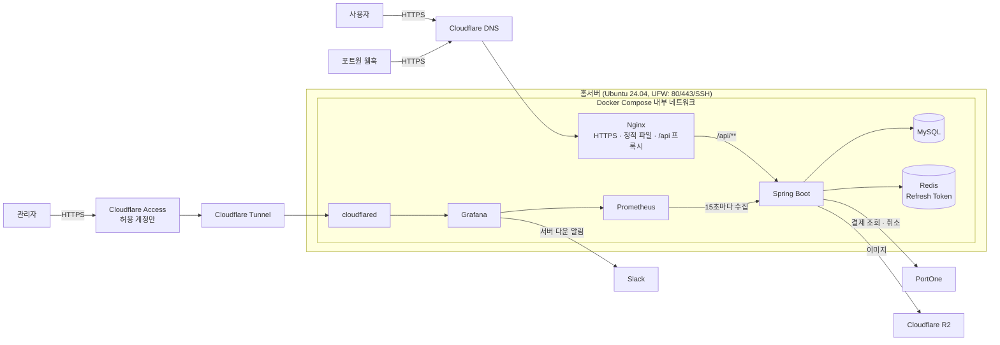
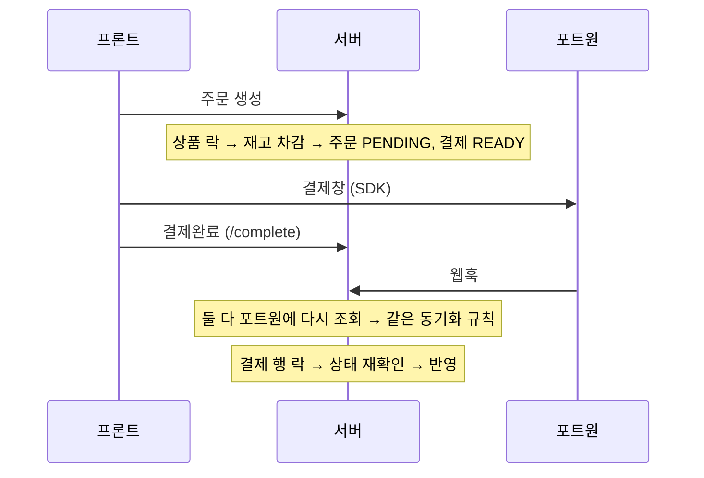

# baseshop

Spring Boot + JPA 기반 쇼핑몰 백엔드입니다.
**홈서버에 Docker 환경을 직접 구축해 HTTPS · CI/CD · 모니터링까지 운영**하고 있고, 포트원(PortOne) V2 결제의 **동시성 · 정합성**과 **대용량 데이터 조회 성능**에 집중했습니다.

- 🚀 서비스 : https://baseshop.co.kr
- 📄 API 문서 : https://baseshop.co.kr/swagger-ui/index.html

<br>

## 📈 핵심 성과

| 주제 | 내용 | 결과 |
| --- | --- | --- |
| 대용량 페이징 | 게시글 100만 건, 뒤 페이지 조회를 커버링 인덱스(지연 조인)로 개선 | **9,427ms → 102ms** |
| 대용량 엑셀 | 상품 10만 건 다운로드를 No Offset 청크 + SXSSF + 스트리밍으로 개선 | **힙 1.5GiB → 142MiB** |
| 결제 정합성 | 결제완료 · 웹훅 · 만료 배치가 같은 동기화 규칙, 비관적 락 + 상태 전이 규칙 | 중복 처리 · 재고 이중 복구 차단 |
| 인프라 · 운영 | 홈서버 Ubuntu + Docker Compose, GitHub Actions 자동 배포, Prometheus · Grafana · Slack 알림 | 외부 공개 포트 80/443만 |

<br>

## 🛠 기술 스택

| 구분 | 기술 |
| --- | --- |
| Backend | Java 17, Spring Boot 4.1, Spring Data JPA, QueryDSL 5, Spring Security, JWT, Apache POI (SXSSF) |
| Database | MySQL 8.4, Redis 7 |
| Infra | Ubuntu Server 24.04 (홈서버), Docker Compose, Nginx, GitHub Actions, GHCR |
| Monitoring | Actuator, Micrometer, Prometheus, Grafana, Slack 알림, Cloudflare Tunnel + Access |
| 외부 연동 | PortOne V2 (결제 · 환불 · 웹훅), Cloudflare R2 (상품 이미지) |
| Frontend | Vue 3 + Vite (연동 확인용) |

<br>

## 🏗 아키텍처



- 외부에 열린 포트는 **Nginx 80/443뿐**이고, Spring · MySQL · Redis · 모니터링 도구는 내부 네트워크에서만 통신합니다.
- Grafana는 포트를 열지 않고 **Cloudflare Tunnel + Access**로 허용된 계정만 접근합니다.
- **CI/CD** : `git push` → GitHub Actions에서 이미지 빌드 → GHCR → SSH로 서버에서 `compose pull → up -d`. 비밀 설정은 GitHub Secret으로 배포 때 주입합니다.
- 인증서(Let's Encrypt)와 유동 IP(DDNS)도 컨테이너로 자동 갱신합니다.

<details>
<summary><b>ERD</b></summary>


</details>

<br>

## ✨ 주요 기능

| 도메인 | 기능 | 포인트 |
| --- | --- | --- |
| 회원 · 인증 | 가입, 로그인, 로그아웃, 재발급 | Access / Refresh 분리, Refresh는 httpOnly 쿠키 + Redis(TTL) |
| 게시판 | CRUD, 페이징 · 검색 | 작성자 본인만 수정 · 삭제, 100만 건 페이징 최적화 |
| 상품 | 관리(관리자), 조회, 이미지, 엑셀 다운로드 | 소프트 삭제, 이미지는 R2, 엑셀은 메모리 일정 |
| 장바구니 · 주문 | 담기, 주문 생성 · 취소 | 재고 선차감(비관적 락), 취소 시 환불 + 재고 복구 |
| 결제 | 결제완료, 웹훅, 만료 배치 | 포트원 재조회로 검증, 금액 불일치 자동 환불 |

<details>
<summary><b>API 목록</b></summary>

| Method | URI | 설명 | 권한 |
| --- | --- | --- | --- |
| POST | `/api/v1/member` | 회원가입 | 누구나 |
| POST | `/api/v1/login` · `/logout` · `/reissue` | 로그인 · 로그아웃 · 재발급 | 누구나 |
| GET | `/api/v1/board`, `/api/v1/board/{id}` | 게시글 목록 · 상세 | 누구나 |
| POST · PUT · DELETE | `/api/v1/board`, `/api/v1/board/{id}` | 게시글 작성 · 수정 · 삭제 | USER, ADMIN |
| GET | `/api/v1/product`, `/api/v1/product/{id}` | 상품 목록 · 상세 | 누구나 |
| POST · PUT · DELETE | `/api/v1/product`, `/api/v1/product/{id}` | 상품 등록 · 수정 · 삭제 | ADMIN |
| PUT | `/api/v1/product/{id}/quantity` | 재고 증감 | ADMIN |
| POST | `/api/v1/product/{id}/file` | 상품 이미지 업로드 | ADMIN |
| GET | `/api/v1/product/excel` | 상품 전체 엑셀 다운로드 | ADMIN |
| GET · POST · PUT · DELETE | `/api/v1/cart` | 장바구니 | USER, ADMIN |
| POST | `/api/v1/order/sheet`, `/api/v1/order` | 주문서, 주문 생성 | USER, ADMIN |
| GET | `/api/v1/order` | 주문 목록 | USER, ADMIN |
| PUT | `/api/v1/order/{id}/cancel` | 주문 취소 | USER, ADMIN |
| POST | `/api/v1/payment/complete` | 결제완료 검증 | USER, ADMIN |
| POST | `/api/v1/payment/webhook` | 포트원 웹훅 | 서명 검증 |

</details>

<br>

## ⚡ 성능 개선

### 1. 게시판 페이징 : 커버링 인덱스 (9,427ms → 102ms)

**문제** : 게시글 100만 건에서 뒤 페이지(`LIMIT 300000, 10`) 조회가 9초 이상
- `board_type` 인덱스가 없어 테이블을 90만 행 읽으며 필터링
- offset만큼 건너뛸 행까지 전부 테이블에서 읽고 버림

**해결**
1. `board_type` 인덱스 추가 (보조 인덱스에 PK가 포함돼 정렬까지 인덱스로 처리)
2. 인덱스만으로 id 10개 조회 → 그 id로 본 데이터 조회 (지연 조인)
   - QueryDSL은 FROM 서브쿼리를 지원하지 않아 쿼리 2번으로 구현, 반환 타입은 유지해서 서비스 · 프론트 변경 없음

| | 테이블 접근 | 실행 시간 |
| --- | --- | --- |
| 개선 전 | 90만 회 | 9,427ms |
| 개선 후 | **10회** | **102ms (약 92배)** |

<details>
<summary>측정 환경 · EXPLAIN ANALYZE</summary>

- 게시글 100만 건 (QNA 약 33만 건), 테이블 884MB / 인덱스 23MB, InnoDB 버퍼 풀 128MB
- `EXPLAIN ANALYZE`, 3회 실행 후 첫 회 제외

**개선 전** — 9,427ms
```
-> Limit/Offset: 10/300000 row(s)  (actual time=9427..9427 rows=10 loops=1)
    -> Filter: (b1_0.board_type = 'QNA')  (actual time=0.0573..9405 rows=300010 loops=1)
        -> Index scan on b1_0 using PRIMARY (reverse)  (actual time=0.052..9308 rows=900030 loops=1)
```

**개선 후** — 102ms
```
-> Nested loop inner join  (actual time=102..102 rows=10 loops=1)
    -> Table scan on t  (actual time=98.5..98.5 rows=10 loops=1)
        -> Materialize  (actual time=98.4..98.4 rows=10 loops=1)
            -> Limit/Offset: 10/300000 row(s)  (actual time=98.1..98.1 rows=10 loops=1)
                -> Covering index lookup on b1_0 using idx_board_board_type (board_type = 'QNA') (reverse)  (actual time=0.147..87.5 rows=300010 loops=1)
    -> Single-row index lookup on b using PRIMARY (board_id = t.board_id)  (actual time=0.00429..0.00432 rows=1 loops=10)
```
</details>

### 2. 상품 엑셀 다운로드 : 메모리 개선 (힙 1.5GiB → 142MiB)

**문제** : `findAll()` + `XSSFWorkbook`으로 상품 10만 건과 엑셀 셀 70만 개를 전부 힙에 올림 → 동시 요청 시 OOM 위험

**해결**
1. **No Offset 청크 조회** : `where id > 마지막id limit 1000`으로 1,000건씩, 필요한 컬럼만 DTO로
2. **SXSSF** : 메모리에는 최근 100행만, 나머지는 임시 파일
3. **StreamingResponseBody** : 출력 스트림에 바로 전송 (`byte[]`로 힙에 올리지 않음). 생성은 응답 전에 끝내서 오류는 정상 JSON 에러로 응답
4. **공통화** : `@ExcelColumn` 어노테이션 + 리플렉션 → 다른 도메인도 DTO만 만들면 재사용

| | 응답 시간 | Heap used 최대 |
| --- | --- | --- |
| 개선 전 | 23.85초 | 약 1.5GiB |
| 개선 후 | **5.50초 (77%↓)** | **142MiB (91%↓)** |

<table>
  <tr>
    <td align="center"><br><b>개선 전</b></td>
    <td align="center"><br><b>개선 후</b></td>
  </tr>
</table>

<details>
<summary>측정 환경</summary>

- 상품 10만 건 (설명 약 500자, 컬럼 7개), 로컬, JVM 힙 기본값, SQL 로그 OFF
- 시간 : 브라우저 Network → Waiting for server response / 메모리 : Grafana JVM Heap `used` 최대값 (측정마다 서버 재시작)
</details>

<br>

## 💳 주문 · 결제 설계



- **검증** : 프론트 결과와 웹훅 body는 믿지 않고 항상 포트원에 다시 조회해 상태와 금액 확인, 금액이 다르면 자동 환불
- **같은 동기화 규칙** : 결제완료 · 웹훅 · 만료 배치(10분 지난 READY)가 같은 메서드를 사용 → 어느 경로로 먼저 와도 결과가 같음
- **동시성** : 재고는 상품 ID 순서로 비관적 락(데드락 방지), 결제는 행 락 + 락 안에서 상태 재확인 → 먼저 락을 잡은 쪽만 반영
- **상태 전이 규칙** : 상태는 엔티티의 `transitTo()`에서만 바뀌고 허용되지 않은 전이는 예외 → 중복 완료 · 중복 취소(재고 이중 복구) 차단
- **Facade + Processor** : 서비스는 자기 도메인만, 여러 도메인 변경은 Processor 한 트랜잭션, **외부 API(포트원)는 트랜잭션 밖**에서 호출해 락과 커넥션을 오래 잡지 않음

| 동시성 테스트 | 결과 |
| --- | --- |
| 재고 100개 상품에 100건 동시 주문 | 재고 정확히 0 |
| 재고 10개 상품에 30건 동시 주문 | 10건 성공, 20건 실패, 재고 음수 없음 |

<details>
<summary><b>동기화 규칙 · 복구 시나리오</b></summary>

| DB 결제 상태 | 포트원 상태 | 처리 |
| --- | --- | --- |
| READY | PAID (금액 일치) | 결제완료 → 주문완료 → 장바구니 삭제 |
| READY | PAID (금액 불일치) | 포트원 환불 → 결제취소 → 주문실패 → 재고복구 |
| READY | FAILED | 결제실패 → 주문실패 → 재고복구 |
| READY | CANCELLED | 결제취소 → 주문실패 → 재고복구 |
| PAID | CANCELLED | 결제취소 → 주문취소 → 재고복구 (콘솔 취소 등) |
| FAILED / CANCELLED | - | 변화 없음 |

| 상황 | 복구 |
| --- | --- |
| 환불은 됐는데 DB 반영 실패 | 웹훅이 포트원 상태로 동기화 |
| 웹훅이 끝내 안 옴 | 만료 배치가 포트원을 확인해서 동기화 |
| 결제창만 열고 닫음 | 만료 배치가 결제실패 · 주문실패 · 재고복구 |

</details>

<br>

## 🚨 트러블슈팅

| 문제 | 원인 | 해결 |
| --- | --- | --- |
| 동시 주문 시 재고 불일치 | 같은 재고를 읽고 각자 차감 (갱신 손실) | 비관적 락 + 상품 ID 순서로 락 |
| 환불은 됐는데 DB는 결제완료 | 환불 후 DB 반영 중 예외 → 롤백 | 웹훅이 포트원 상태로 동기화하는 규칙 추가 |
| 결제 취소 성공인데 실패로 처리 | enum과 문자열을 `equals` 비교 → 항상 false | enum은 `==`로 비교 |
| 배포 후 POST만 403 | Nginx가 Host 헤더를 바꿔 전달 → 다른 출처로 판단 | `proxy_set_header Host $http_host` |
| 운영 모니터링에 데이터 없음 | 운영 설정에 actuator 노출 누락 → 수집 경로 500 | 운영 설정 추가, 수집 상태(`up`)로 확인 |
| R2 업로드 403 | R2가 chunked encoding 미지원 | `chunkedEncodingEnabled(false)` |

<br>

## 📝 한계와 개선 계획

| 현재 | 개선 방향 |
| --- | --- |
| 주문 생성 멱등성 없음 | 버튼 비활성화 + Idempotency-Key |
| 웹훅 수신 이력 없음 | webhook-id 중복 기록, 처리 결과 추적 |
| 배포 시 수십 초 중단 | Nginx upstream 블루그린 배포 |
| 테스트 부족 | 서비스 테스트 보강 → 통과 시에만 배포 |
| DB 백업 없음 | mysqldump 정기 백업 |

<details>
<summary><b>그 밖의 설계 · 패키지 구조 · 로컬 실행</b></summary>

**그 밖의 설계**
- 인증 : JSON 로그인 `LoginFilter`, `JWTFilter` 검증, 재발급 시 쿠키와 Redis 값 비교, 로그아웃 시 Redis 키 삭제
- 권한 2단계 : URL 권한은 Security, 데이터 권한(내 글 · 내 주문)은 서비스와 쿼리 조건. 남의 결제는 존재 여부를 숨기려고 404
- 파일 : `FileStore` 인터페이스 + `@Profile`로 Local / R2 교체, 저장 실패 시 보상 삭제, 확장자 · Content-Type 검사
- 조회 : LAZY + fetch join / `default_batch_fetch_size`, OSIV OFF
- 예외 : `@RestControllerAdvice` + 공통 응답, 400 · 404 · 405 구분

**패키지 구조**
```text
com.baseshop
├── member · login · security   # 회원, 인증(JWT), 권한
├── board · product · cart      # 게시판, 상품, 장바구니
├── order · payment             # controller / facade(Facade, Processor) / service / entity
├── portone                     # 포트원 API 클라이언트, 웹훅 서명 검증
├── scheduler                   # 결제 만료 배치, 파일 정리 배치
└── common                      # 공통 응답, 예외, 파일 저장, 엑셀
```


</details>
