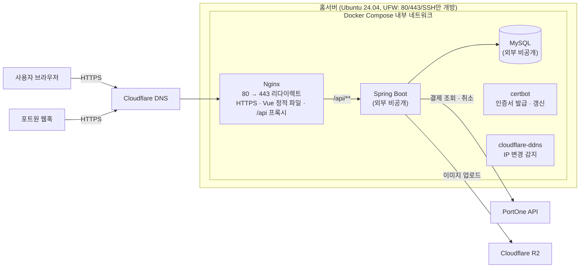
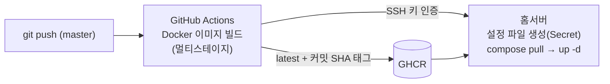
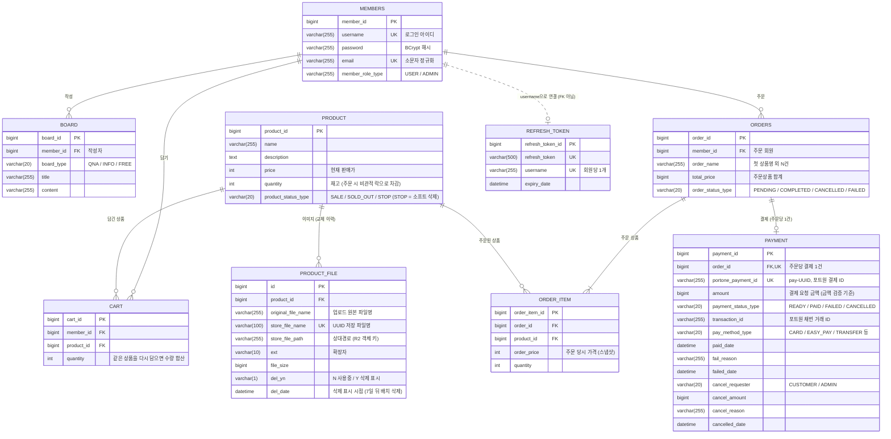
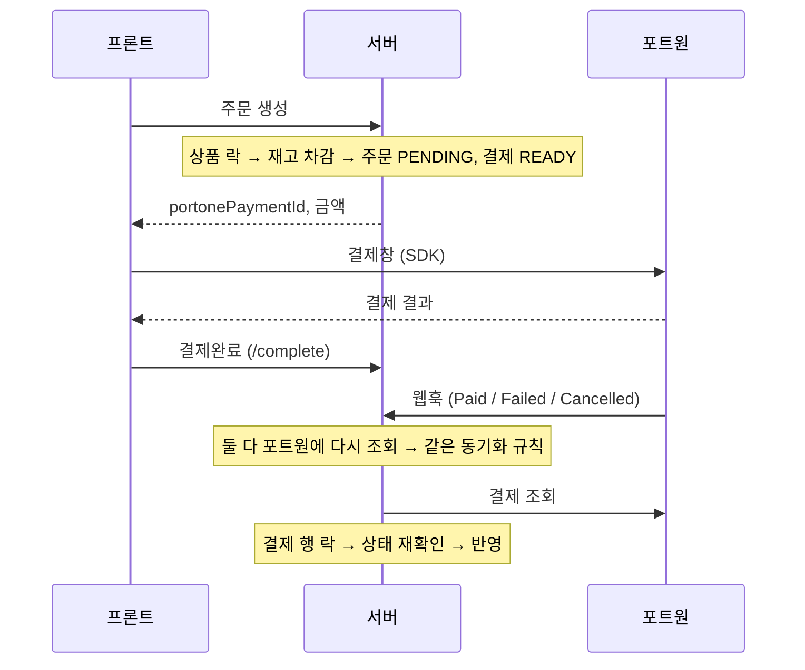

# baseshop

Spring Boot + JPA 기반 쇼핑몰 백엔드 프로젝트입니다.
회원, 게시판, 상품, 장바구니, 주문, 결제 API를 만들고, **홈서버에 직접 Docker 환경을 구축해 HTTPS와 CI/CD까지 운영**하고 있습니다.
결제는 **포트원(PortOne) V2**를 연동해 결제 검증, 웹훅 동기화, 환불까지 처리했고, 재고와 결제 상태의 **동시성·정합성**에 가장 많이 신경 썼습니다.

- 🚀 서비스 : https://baseshop.co.kr
- 📄 API 문서 (Swagger) : https://baseshop.co.kr/swagger-ui/index.html

> 프론트엔드(Vue 3)는 API 연동 확인용으로 AI 도구를 활용해 만들었습니다. 이 저장소는 **백엔드**를 다룹니다.

<br>

## 📌 목차

1. [기술 스택](#-기술-스택)
2. [아키텍처](#-아키텍처)
3. [ERD](#-erd)
4. [주요 기능](#-주요-기능)
5. [주문 · 결제 설계](#-주문--결제-설계)
6. [그 밖의 설계](#-그-밖의-설계)
7. [트러블슈팅](#-트러블슈팅)
8. [테스트](#-테스트)
9. [패키지 구조](#-패키지-구조)
10. [로컬 실행](#-로컬-실행)
11. [한계와 개선 계획](#-한계와-개선-계획)

<br>

## 🛠 기술 스택

| 구분 | 기술 |
| --- | --- |
| Backend | Java 17, Spring Boot 4.1, Spring Data JPA, QueryDSL 5, Spring Security, JWT(jjwt 0.13), Bean Validation, springdoc-openapi |
| Database | MySQL 8.4 |
| 외부 연동 | PortOne V2 (결제 조회 · 취소 · 웹훅), Cloudflare R2 (상품 이미지, AWS SDK v2 S3 호환) |
| Infra | Ubuntu Server 24.04 (홈서버), Docker, Docker Compose, Nginx |
| CI/CD | GitHub Actions, GHCR (GitHub Container Registry) |
| 도메인 / 보안 | Cloudflare DNS, Let's Encrypt (certbot, DNS-01), DDNS, UFW, fail2ban |
| Frontend | Vue 3 + Vite (연동 확인용) |

<br>

## 🏗 아키텍처

### 서버 구성



- 클라우드 대신 **집 데스크탑에 Ubuntu Server를 설치**하고, Nginx · Spring · MySQL을 컨테이너로 운영합니다.
- Spring과 MySQL은 호스트 포트를 열지 않고 Docker 내부 네트워크에서만 통신합니다.
- 프론트와 API를 같은 도메인(`/api`)으로 묶어 CORS 없이 동작합니다.
- 유동 IP는 DDNS 컨테이너가 감지해 Cloudflare DNS 레코드를 자동으로 수정합니다.

### CI/CD



- 빌드는 Actions에서 하고 서버는 이미지만 받아서 교체합니다. 운영 서버에 빌드 부하가 없습니다.
- `application-prod.properties`는 git에 없고, GitHub Secret으로 배포 때 서버에 파일로 만들어 읽기 전용 볼륨으로 주입합니다.
- 저장소는 3개로 나눴습니다: `baseshop`(백엔드), `baseshop-front`(프론트), `baseshop-deploy`(compose · 스크립트).

<br>

## 🗂 ERD


<details>
<summary><b>ERD (Mermaid, 컬럼 전체)</b></summary>



</details>

**공통 컬럼** : `refresh_token`을 제외한 모든 테이블에 `reg_id`, `reg_date`, `mod_id`, `mod_date`가 있습니다. (JPA Auditing, `BaseEntity`)

<details>
<summary><b>테이블 설명</b></summary>

| 테이블 | 설명 | 설계 포인트 |
| --- | --- | --- |
| `members` | 회원 | `username`, `email` 유니크. 비밀번호는 BCrypt 해시. 권한은 USER / ADMIN |
| `board` | 게시글 | 작성자(`member_id`)만 수정 · 삭제 가능. 게시판 구분은 enum 문자열 저장 |
| `product` | 상품 | 재고(`quantity`)는 주문 시 `SELECT ... FOR UPDATE`로 락을 잡고 차감. 삭제는 상태를 STOP으로 바꾸는 소프트 삭제 |
| `product_file` | 상품 이미지 | 교체해도 이전 행을 지우지 않고 `del_yn = 'Y'`로 표시 → 7일 뒤 배치가 실제 파일과 행 삭제. 경로는 상대경로만 저장 (로컬 ↔ R2 전환에도 DB 값 그대로) |
| `cart` | 장바구니 | 같은 상품을 다시 담으면 새 행 대신 수량 합산 (서비스에서 조회 후 처리). 결제 완료 시 주문한 상품만 삭제 |
| `orders` | 주문 | 결제 전 PENDING으로 생성. 결제 결과에 따라 COMPLETED / FAILED, 결제 후 취소는 CANCELLED. 상태 전이 규칙을 엔티티가 관리 |
| `order_item` | 주문 상품 | `order_price`에 주문 당시 가격을 저장해서, 나중에 상품 가격이 바뀌어도 주문 금액은 그대로 |
| `payment` | 결제 | 주문당 1건(`order_id` 유니크). `portone_payment_id`로 포트원과 연결. `amount`는 포트원 실제 결제 금액과 비교하는 기준. 상태별 시점 · 사유(완료 · 실패 · 취소)를 컬럼으로 기록 |
| `refresh_token` | Refresh Token | 회원당 1개(`username` 유니크). 재발급 때 저장된 값과 비교, 로그아웃 시 삭제. 회원과 FK 없이 username으로 조회 |

</details>

<details>
<summary><b>관계 설명</b></summary>

| 관계 | 종류 | 설명 |
| --- | --- | --- |
| members – orders | 1 : N | 회원 한 명이 여러 주문 |
| orders – order_item | 1 : N | 주문 하나에 여러 상품. 주문 엔티티에서만 양방향(`orderItemList`) |
| product – order_item | 1 : N | 주문 상품은 상품을 참조하되 가격은 따로 저장 |
| orders – payment | 1 : 1 | `payment.order_id` 유니크 FK. 결제 쪽에서만 주문을 참조(단방향) |
| members – cart, product – cart | 1 : N | 회원과 상품의 다대다를 장바구니 행으로 풀어냄 |
| product – product_file | 1 : N | 이미지 교체 이력이 쌓임. 단방향(상품 → 이미지 컬렉션 없음) |
| members – board | 1 : N | 작성자 |
| members – refresh_token | 1 : 0..1 | FK가 아니라 `username`으로 연결 |

- 연관관계는 모두 LAZY이고, 필요한 곳에서만 fetch join(ToOne) 또는 `default_batch_fetch_size`(ToMany)로 가져옵니다.
- 양방향은 생명주기가 같은 주문 – 주문상품에만 썼습니다.

</details>

<br>

## ✨ 주요 기능

| 도메인 | 기능 | 포인트 |
| --- | --- | --- |
| 회원 · 인증 | 회원가입, 로그인, 로그아웃, 토큰 재발급 | Access / Refresh 분리, Refresh는 httpOnly 쿠키 + DB 저장(회원당 1개) |
| 게시판 | CRUD, 페이징 · 검색 | 작성자 본인만 수정 · 삭제 (소유권 검증 → 403) |
| 상품 | 등록 · 수정 · 삭제(관리자), 조회, 이미지 업로드 | 삭제는 STOP 상태로 소프트 삭제, 재고는 증감값 API로 분리, 이미지는 R2 |
| 장바구니 | 담기, 수량 변경, 삭제, 목록 | 같은 상품을 다시 담으면 수량만 증가, 결제 완료 시 주문한 상품만 삭제 |
| 주문 | 주문서, 주문 생성, 목록, 취소 | 재고 선차감(비관적 락), 주문 당시 가격 저장, 취소 시 포트원 환불 + 재고 복구 |
| 결제 | 결제완료, 웹훅, 만료 배치 | 포트원 재조회로 검증, 금액 불일치 자동 환불, 세 경로가 같은 동기화 규칙 사용 |

<details>
<summary><b>API 목록</b></summary>

| Method | URI | 설명 | 권한 |
| --- | --- | --- | --- |
| POST | `/api/v1/member` | 회원가입 | 누구나 |
| POST | `/api/v1/login` | 로그인 | 누구나 |
| POST | `/api/v1/logout` | 로그아웃 | 누구나 |
| POST | `/api/v1/reissue` | Access Token 재발급 | 누구나 (Refresh 쿠키) |
| GET | `/api/v1/board`, `/api/v1/board/{id}` | 게시글 목록 · 상세 | 누구나 |
| POST · PUT · DELETE | `/api/v1/board`, `/api/v1/board/{id}` | 게시글 작성 · 수정 · 삭제 | USER, ADMIN |
| GET | `/api/v1/product`, `/api/v1/product/{id}` | 상품 목록 · 상세 | 누구나 |
| POST · PUT · DELETE | `/api/v1/product`, `/api/v1/product/{id}` | 상품 등록 · 수정 · 삭제 | ADMIN |
| PUT | `/api/v1/product/{id}/quantity` | 재고 증감 | ADMIN |
| POST | `/api/v1/product/{id}/file` | 상품 이미지 업로드 | ADMIN |
| GET · POST · PUT · DELETE | `/api/v1/cart` | 장바구니 | USER, ADMIN |
| POST | `/api/v1/order/sheet` | 주문서 | USER, ADMIN |
| POST | `/api/v1/order` | 주문 생성 | USER, ADMIN |
| GET | `/api/v1/order` | 주문 목록 | USER, ADMIN |
| PUT | `/api/v1/order/{id}/cancel` | 주문 취소 | USER, ADMIN |
| POST | `/api/v1/payment/complete` | 결제완료 검증 | USER, ADMIN |
| POST | `/api/v1/payment/webhook` | 포트원 웹훅 | 서명 검증 |

</details>

<br>

## 💳 주문 · 결제 설계

### 결제 흐름



- 프론트에서 받은 결과와 웹훅 body는 믿지 않고, **항상 포트원에 다시 조회**해서 상태와 금액을 확인합니다.
- 웹훅이 `/complete`보다 먼저 오는 경우가 많아서, 두 경로가 **같은 동기화 메서드**를 사용합니다.
- 결제창만 열고 닫은 주문은 **만료 배치**(5분마다, 10분 지난 READY)가 정리합니다.

### 동기화 규칙

| DB 결제 상태 | 포트원 상태 | 처리 |
| --- | --- | --- |
| READY | PAID (금액 일치) | 결제완료 → 주문완료 → 장바구니 삭제 |
| READY | PAID (금액 불일치) | 포트원 환불 → 결제취소 → 주문실패 → 재고복구 |
| READY | FAILED | 결제실패 → 주문실패 → 재고복구 |
| READY | CANCELLED | 결제취소 → 주문실패 → 재고복구 (환불 후 DB 반영 실패 복구) |
| READY | 결제 진행 중 | 변화 없음 (결과가 나오면 웹훅이 처리) |
| PAID | CANCELLED | 결제취소 → 주문취소 → 재고복구 (콘솔 취소 등) |
| FAILED / CANCELLED | - | 변화 없음 (끝난 결제) |

### Facade + Processor

처음에는 주문 서비스가 결제 · 상품 서비스를 부르고, 결제 서비스가 상품 · 장바구니 · 포트원까지 의존해서 서비스끼리 얽혀 있었습니다.
또 결제 행 락을 잡은 채로 포트원 환불(HTTP)을 호출하고 있었습니다. 그래서 계층을 다음과 같이 나눴습니다.

```text
Controller
 ├─ 한 도메인만 (주문 목록 등)        → Service
 └─ 여러 도메인 조합                 → Facade      : 조합, 포트원 호출 (트랜잭션 밖)
                                       └─ Processor : 여러 도메인 변경을 한 트랜잭션으로
                                             └─ Service (자기 도메인만) / Entity (상태 규칙)
```

- **Service는 자기 도메인만** 다루고 서로 의존하지 않습니다.
- **외부 API는 트랜잭션 밖**에서 호출해, 응답이 느려도 DB 락과 커넥션을 오래 잡지 않습니다.
  - 예외: 금액 불일치 환불은 거의 일어나지 않는 경우라 단순하게 트랜잭션 안에서 처리했습니다.
- Processor를 별도 빈으로 둔 이유는 같은 클래스 안에서 `@Transactional` 메서드를 부르면 프록시를 거치지 않아 트랜잭션이 걸리지 않기 때문입니다.
- 락 조회처럼 호출하는 쪽 트랜잭션 안에서만 의미 있는 메서드는 `Propagation.MANDATORY`로 실수를 막았습니다.

### 상태 전이 규칙

```java
// OrderStatusType
public boolean canTransitTo(OrderStatusType target) {
    return switch (this) {
        case PENDING -> target == COMPLETED || target == FAILED;
        case COMPLETED -> target == CANCELLED;
        case CANCELLED, FAILED -> false;
    };
}
```

- 상태는 엔티티의 `transitTo()` 한 곳에서만 바뀌고, 허용되지 않은 전이는 예외로 막습니다. → 중복 완료, 중복 취소(재고 이중 복구) 차단
- Order는 상태만 바뀌어서 `transitTo(상태)`, Payment는 결제일 · 사유 같은 값도 같이 저장해서 `complete()` · `fail()` · `cancel()` + private `transitTo`로 나눴습니다.
- 주문 실패(FAILED, 시스템이 처리)와 주문 취소(CANCELLED, 사람이 취소)를 구분합니다.

### 동시성과 멱등성

| 대상 | 방법 |
| --- | --- |
| 재고 차감 | `where id in (...) order by id for update` 한 번으로 상품 락 → 항상 같은 순서라 데드락 방지 |
| 재고 복구 | 상품 ID 순서로 락 (차감과 같은 순서) |
| 결제 상태 변경 | 결제 행 비관적 락 + 락 안에서 상태 재확인 |

| 같은 요청이 여러 번 오면 | 결과 |
| --- | --- |
| 결제완료 새로고침 · 재요청 | 끝난 결제는 저장된 결과를 그대로 반환 |
| 웹훅 재전송 (최대 5회) | 끝난 결제는 동기화 전에 종료 |
| 결제완료와 웹훅 동시 도착 | 먼저 락을 잡은 쪽만 반영 |
| 만료 배치와 웹훅 동시 | 락 안에서 READY 재확인 |

### 외부 결제와 DB가 어긋나는 경우

| 상황 | 복구 |
| --- | --- |
| 주문취소 환불은 됐는데 DB 반영 실패 | 웹훅(DB PAID + 포트원 CANCELLED)이 동기화 |
| 금액 불일치 환불 후 DB 반영 실패 | 웹훅(DB READY + 포트원 CANCELLED)이 동기화 |
| 금액 불일치 환불 실패 | 롤백 → READY 유지 → 다음 웹훅에서 재시도 |
| 웹훅이 끝내 안 옴 | 만료 배치가 포트원을 확인해서 동기화 |
| 결제창만 열고 닫음 | 만료 배치가 결제실패 · 주문실패 · 재고복구 |

<br>

## 🧩 그 밖의 설계

<details>
<summary><b>인증 (JWT Access + Refresh)</b></summary>

- 로그인은 JSON 기반 커스텀 `LoginFilter`, 이후 요청은 `JWTFilter`가 서명 · 만료 · 토큰 종류를 검증합니다.
- Access Token은 짧게 Authorization 헤더로, Refresh Token은 httpOnly · SameSite=Lax · Secure 쿠키로 내려주고 DB에 회원당 1개 저장합니다.
- 로그아웃하면 DB의 Refresh Token을 삭제해 재발급을 막습니다.
- 토큰에 tokenType을 넣어 Refresh Token을 Access Token처럼 쓰는 것을 막았습니다.

</details>

<details>
<summary><b>권한 2단계</b></summary>

- URL 단위 권한은 Spring Security (`authorizeHttpRequests`), 데이터 단위 권한(내 글인지, 내 주문인지)은 서비스나 쿼리 조건에서 확인합니다.
- 결제완료에서 남의 결제를 요청하면, 존재 여부를 알려주지 않도록 없는 결제와 같은 404를 줍니다.

</details>

<details>
<summary><b>파일 업로드 (Cloudflare R2)</b></summary>

- 저장소를 `FileStore` 인터페이스로 추상화하고 `LocalFileStore`, `R2FileStore`를 `@Profile`로 환경마다 하나만 등록합니다.
- DB에는 상대경로만 저장해서 저장소를 바꿔도 DB 값은 그대로입니다.
- 파일 저장 후 DB 저장(`saveAndFlush`)이 실패하면 방금 저장한 파일을 지웁니다 (보상 삭제).
- 이미지 교체 시 기존 파일은 `del_yn`으로 표시만 하고, 매일 새벽 배치가 7일 지난 파일을 정리합니다.
- 확장자 화이트리스트 + Content-Type 검사, 5MB 제한.

</details>

<details>
<summary><b>조회 성능</b></summary>

- 연관관계는 LAZY, ToOne은 fetch join, ToMany는 `default_batch_fetch_size`로 IN 쿼리 묶음.
- OSIV를 끄고, 트랜잭션 밖(Facade)에서 쓰는 연관 엔티티는 fetch join으로 미리 로딩합니다.
- QueryDSL 동적 쿼리에서 "내 주문만" 같은 필수 조건은 null이 되지 않게 분리했습니다.

</details>

<details>
<summary><b>예외 응답 통일</b></summary>

- `@RestControllerAdvice` + 공통 응답 `ApiResponse`로 모든 응답 형식을 맞췄습니다.
- 잘못된 파라미터, 없는 경로, 지원하지 않는 메서드가 500으로 나가던 것을 400 · 404 · 405로 구분했습니다.

</details>

<br>

## 🚨 트러블슈팅

| 문제 | 원인 | 해결 |
| --- | --- | --- |
| 웹훅 `type`이 null | 포트원 콘솔 웹훅 버전이 2024-01-01 (type, data가 없는 형식) | 웹훅 버전을 2024-04-25로 변경 |
| 결제 취소 성공인데 실패로 처리 | 취소 상태가 enum인데 문자열과 `equals` 비교 → 항상 false | enum은 `==`로 비교 |
| 환불은 됐는데 DB는 결제완료 | 환불 후 DB 반영 중 예외 → 롤백 | 웹훅이 포트원 상태로 동기화하도록 규칙 추가 |
| 서비스끼리 얽히고 락 잡은 채 외부 API 호출 | 주문 · 결제 서비스가 서로 의존, 트랜잭션 안에서 포트원 호출 | Facade + Processor로 분리, 외부 호출은 트랜잭션 밖 |
| 동시 주문 시 재고가 맞지 않음 | 같은 재고를 읽고 각자 차감 (갱신 손실) | 비관적 락 + 상품 ID 순서로 락 |
| Spring이 DB 연결 실패 | MySQL 초기화 전에 Spring이 먼저 접속 | MySQL healthcheck + `depends_on: service_healthy` |
| 배포 후 POST만 403 | Nginx가 Host 헤더를 바꿔 전달 → 다른 출처로 판단 | `proxy_set_header Host $http_host` |
| R2 업로드 403 | R2가 chunked encoding을 지원하지 않음 | `chunkedEncodingEnabled(false)` |

> 자세한 과정은 [정리 문서 링크]에 있습니다.

<br>

## 🧪 테스트

| 테스트 | 결과 |
| --- | --- |
| 재고 100개 상품에 100건 동시 주문 | 재고 정확히 0 |
| 재고 10개 상품에 30건 동시 주문 | 10건 성공, 20건 실패, 재고 0 (음수 없음) |

- `src/test/java/com/baseshop/order/service/OrderServiceTest.java`

<br>

## 📁 패키지 구조

```text
com.baseshop
├── member · login · security   # 회원, 인증(JWT), 권한
├── board                       # 게시판
├── product                     # 상품, 상품 이미지
├── cart                        # 장바구니
├── order
│   ├── controller
│   ├── facade                  # OrderFacade, OrderProcessor
│   ├── service                 # 주문 도메인만
│   └── entity · type · dto · repository
├── payment
│   ├── controller              # 결제완료, 웹훅
│   ├── facade                  # PaymentFacade, PaymentProcessor
│   ├── service                 # 결제 도메인만
│   └── entity · type · dto · repository
├── portone                     # 포트원 API 클라이언트, 웹훅 서명 검증
├── scheduler                   # 결제 만료 배치, 파일 정리 배치
└── common                      # 공통 응답, 예외 처리, 파일 저장, 설정
```

<br>

## ▶ 로컬 실행

**필요한 것** : JDK 17, MySQL 8.x (또는 MariaDB)

설정 파일은 git에 올리지 않습니다. `src/main/resources/application-local.properties`를 만들고 아래 키를 채워주세요.

```properties
spring.datasource.url=
spring.datasource.username=
spring.datasource.password=
spring.jpa.open-in-view=false
spring.jpa.properties.hibernate.default_batch_fetch_size=100

jwt.secret=
jwt.access-token-expire-time=
jwt.refresh-token-expire-time=
jwt.access-token-name=
jwt.refresh-token-name=
jwt.cookie-secure=false

file.dir=
file.url=

portone.api.base-url=https://api.portone.io
portone.api.secret=
portone.store.id=
portone.channel.toss=
portone.webhook-secret=

batch.payment-expire-minutes=10
batch.file-retention-days=7
```

```bash
./gradlew bootRun --args='--spring.profiles.active=local'
```

- Swagger : `http://localhost:8080/swagger-ui/index.html`
- 로컬에서 웹훅을 받으려면 `cloudflared tunnel --url http://localhost:8080`으로 임시 HTTPS 주소를 만들어 포트원 콘솔에 등록합니다.

<br>

## 📝 한계와 개선 계획

| 현재 | 개선 방향 |
| --- | --- |
| 주문 생성 멱등성 없음 (두 번 클릭 시 주문 2개) | 버튼 비활성화 + Idempotency-Key |
| 판매중지 상품 주문 차단 없음 | Product에 주문 가능 검증, 주문서 · 주문 생성에 적용 |
| 웹훅 수신 이력 없음 | webhook-id 중복 기록, 처리 결과 추적 테이블 |
| 배포 시 수십 초 중단 | Nginx upstream + 헬스체크 롤링 / 블루그린 배포 |
| 테스트 부족, 이미지 빌드 시 테스트 생략 | 서비스 테스트 보강 → 테스트 통과 시에만 배포 |
| 서버 1대 | 다중 인스턴스 시 스케줄러 중복 실행 방지(ShedLock) |
| DB 백업 · 모니터링 없음 | mysqldump 백업, 모니터링 구성 |
